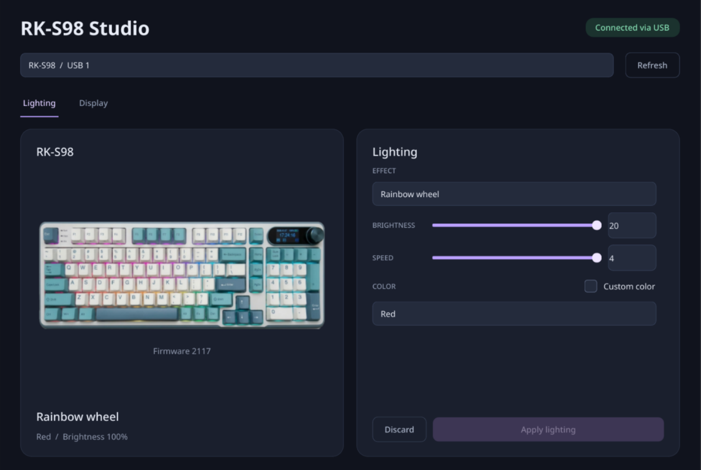

# RK-S98 Studio

> [!WARNING]
> **Use at your own risk: direct hardware writes can damage your keyboard.**
> This experimental app sends configuration and image data using a
> reverse-engineered protocol. It may corrupt settings or make a device
> unusable; there is no guaranteed recovery or automatic rollback. The authors
> and contributors provide no warranty and accept no liability to the fullest
> extent permitted by law. See the [MIT license](LICENSE). Continue only if
> you understand and accept these risks.

Linux desktop controls for the Royal Kludge RK-S98: RGB lighting, display
images and GIFs, and keyboard clock sync. Built with Python, PySide6, and
HIDAPI; no account or network connection is required.

This is independent experimental software, not an official Royal Kludge app.
It has been tested on one wired RK-S98; other firmware versions may behave
differently.



## Features

- Select lighting effects, brightness, speed, and built-in or custom colors.
- Upload still images and GIFs with crop, zoom, fit, and animation preview.
- Read back lighting settings, view firmware version, and sync the keyboard
  clock to local computer time.
- Refresh and device discovery do not write configuration.

## Requirements

- Linux with a graphical desktop session.
- RK-S98 connected in wired USB mode. Bluetooth and the 2.4 GHz receiver are
  unsupported.
- Python 3.11 or newer for source installation.

The app checks both USB identity (`258a:01af`) and the HID report descriptor
before opening a configuration interface.

## Install

### Linux packages

Debian/Ubuntu/Mint `.deb` and Arch/CachyOS `.pkg.tar.zst` installers are
available from [GitHub Releases](https://github.com/Leon2209/RkS98-Studio/releases)
and the Linux builds workflow. Packages include Python, Qt, a launcher, and a
USB permission rule. See [packaging instructions](docs/packaging.md) for
compatibility, install, and uninstall details.

After installation, reconnect the keyboard and launch **RK-S98 Studio** from
the application menu or run `rks98`. Do not run the app as root.

### From source

```sh
python3 -m venv .venv
.venv/bin/python -m pip install -e .
.venv/bin/rks98
```

For source installs, install the device permission rule and reconnect the
keyboard:

```sh
sudo install -m 0644 udev/70-rks98.rules /etc/udev/rules.d/70-rks98.rules
sudo udevadm control --reload-rules
```

To list candidate device interfaces without changing settings:

```sh
.venv/bin/rks98 --list
```

## Use

Select an effect and adjust its controls in the lighting panel, then click
**Apply lighting**. In the display panel, choose an image or GIF, adjust the
crop or fit, preview animation if applicable, and click **Upload to keyboard**.
Uploading replaces the current display image. **Sync clock** sends the
computer's local date and time.

## Limitations and safety

- Custom-color history is stored locally; it is not hardware readback and is
  never reapplied automatically. A custom-color write replaces the full color
  table and may overwrite colors set elsewhere.
- Failed writes can leave partial changes. Do not use another configurator at
  the same time; there is no automatic rollback.
- Image upload cancellation does not restore the previous image. USB
  acknowledgements do not guarantee the physical display result.
- Wireless support, firmware updates, key remapping, and per-key lighting are
  not implemented.

See the [protocol reference](docs/protocol.md) for packet details and hardware
evidence.

## Development

```sh
.venv/bin/python -m pip install -e '.[dev]'
.venv/bin/python -m ruff check .
.venv/bin/python -m ruff format --check .
QT_QPA_PLATFORM=offscreen .venv/bin/python -m pytest -q
```

Automated tests use fake transports and do not write to hardware. Read
[contribution guidelines](CONTRIBUTING.md) before making changes.

Code and project artwork are licensed under the [MIT license](LICENSE).
Third-party licenses and attributions are listed in
[third-party notices](THIRD_PARTY_NOTICES.md).

Developed with AI assistance and human direction/review; human contributors
remain responsible for changes and their validation.
